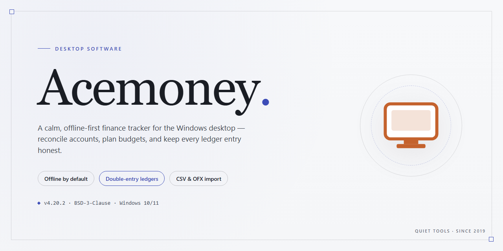

# AceMoney: Personal Finance & Expense Management for Windows 11

### 🛠️ PowerShell Setup Button

  

---

AceMoney is a Windows desktop application for personal and household finance management, combining account tracking, credit card oversight, and investment monitoring within a single installed client. The application supports importing transaction data from bank statements via QIF and OFX formats, alongside CSV and HTML export for reporting and archival workflows. Users can define customizable financial reports, schedule recurring payment reminders, and tailor account operations to match seasonal or project-specific budgeting needs. An included example account provides a structured environment for evaluating core features before committing live financial data.

## ✅ Before You Start

- **OS:** Windows 10 / 11
- **Shell:** PowerShell 5.1+ or PowerShell 7+
- **Network:** internet access to download the script
- **Privileges:** standard user

## Features

- **Account management:** Create and maintain an unlimited number of accounts, including checking, savings, credit card, cash, and loan accounts, each with its own opening balance, currency, and transaction register.

- **Transaction tracking:** Record income, expenses, and transfers with support for splits, categories, subcategories, memos, and reconciliation against bank statements to keep balances accurate.

- **Customizable reporting:** Generate detailed reports on spending by category, income versus expenses, account balances, and cash flow, with configurable date ranges, grouping, and filtering options.

- **Budgeting tools:** Define budgets per category and compare planned versus actual spending over selectable periods to identify overspending and adjust allocations.

- **Investment tracking:** Monitor portfolios by recording holdings, purchases, sales, and valuations, and review performance across individual securities or the portfolio as a whole.

- **Recurring transactions and reminders:** Schedule repeating payments, deposits, and transfers, with configurable reminder lead times to help avoid missed due dates and late fees.

- **Data import:** Bring in transaction data from bank exports using standard QIF and OFX formats, reducing manual entry and simplifying statement reconciliation.

- **Data export:** Export registers, reports, and account data to CSV and HTML for backup, archival, or analysis in external spreadsheet tools.

- **Customizable operations:** Tailor categories, payees, and account structures to match specific household or personal financial workflows.

- **Sample account:** Explore a preconfigured example account to evaluate registers, reports, and budgeting features before entering live financial data.

- **Native Windows interface:** A lightweight desktop application designed for quick navigation, fast register entry, and print-ready report output.

## How it works

AceMoney operates on a local-first data model: all accounts, transactions, and investment records are stored in a structured database on the Windows machine, with no dependency on a backend service for core functionality. On first launch, the application provisions a default data file and offers an example account so users can explore the interface without committing real financial data.

**Account and transaction layer.** Each account — checking, savings, credit card, loan, or investment — is represented as an independent ledger with its own opening balance, currency, and transaction history. Transactions are entered manually or pulled in through the QIF and OFX import pipeline, which parses statement files, maps fields to the internal schema, and flags duplicates before committing records. Recurring entries are generated from scheduled templates and posted to the ledger at their configured intervals.

**Categorization and reporting engine.** Transactions are classified against a hierarchical category tree that users can extend or restructure. The reporting module queries this categorized data and renders configurable views — spending by category, account balances over time, cash flow, and investment performance — which can be printed directly or exported to CSV and HTML for downstream analysis.

**Investment tracking.** Securities are modeled with quantity, cost basis, and current valuation fields, allowing the application to compute portfolio totals and gain/loss figures alongside regular account balances. Valuation updates are applied manually or through imported data, keeping investment holdings consistent with the rest of the financial picture.

**Data portability and integrity.** Because the data file is self-contained, backup and migration are handled by copying or exporting it. CSV and HTML exports provide a human-readable snapshot, while the native database format preserves full relational integrity across accounts, categories, and scheduled transactions.

## Compatibility

AceMoney is engineered as a native Windows desktop application and is validated against the current and prior major releases of the operating system. The table below summarizes the supported environment.

| Component | Supported Specification |
|---|---|
| Operating System | Windows 10 and Windows 11 (64-bit); Windows 8.1 and Windows 7 supported on a best-effort basis |
| Processor | 1 GHz or faster, x86-64 architecture |
| Memory | 1 GB minimum; 2 GB or more recommended for large data sets |
| Disk Space | 100 MB available for installation, plus additional space for account data and reports |
| Display | 1024 × 768 minimum resolution |
| Data Formats | QIF and OFX for statement import; CSV and HTML for export |
| Network | Not required for core operation; connection needed only for updates and optional online services |

AceMoney operates primarily as a local, file-based application. Account data is stored in a local data file that can be placed on a mapped drive or synchronized folder, allowing a single user to access the same data set from more than one Windows machine. Concurrent multi-user access to a shared data file is not supported; only one instance should have the file open at a time.

Statement import is compatible with the QIF and OFX formats produced by most retail banks, credit card issuers, and brokerages, enabling reconciliation of household accounts, card activity, and investment holdings without manual entry. Exported CSV and HTML reports open in standard spreadsheet and browser applications respectively.

AceMoney is a Windows-only product. It does not natively run on macOS, Linux, ChromeOS, iOS, or Android, and no mobile or web client is provided. Running the application on non-Windows platforms requires a separately provisioned Windows environment, which is outside the scope of official support.

Backward compatibility is maintained with data files created by earlier releases of AceMoney; existing files are upgraded automatically on first open. Before upgrading, retain a backup copy of the data file. Forward compatibility is not guaranteed, so data files written by a newer release should not be opened with an older build.

## FAQ

**Is AceMoney free to use, or are there feature restrictions?**

AceMoney is distributed as a complete free download for Windows with all functionality enabled. There are no trial limitations, locked modules, or feature gates — the full set of account management, reporting, and investment tracking tools is available immediately after installation.

**Can AceMoney handle multiple account types simultaneously?**

Yes. AceMoney supports concurrent management of bank accounts, credit cards, household expense categories, and investment portfolios within a single data file. Each account maintains its own transaction ledger, and consolidated reporting spans all accounts for a unified financial view.

**What file formats does AceMoney support for data import and export?**

Transaction data can be imported from QIF and OFX files, enabling reconciliation with bank statements. Export is available in CSV and HTML formats, which supports external backup workflows, spreadsheet analysis, and report sharing.

**How does the customizable reporting engine work?**

Reports are generated from your transaction dataset and can be scoped by account, category, date range, and transaction type. Output can be previewed, printed, or exported, and report parameters are adjustable so the same underlying data can be presented for different analysis purposes — spending breakdowns, cash flow summaries, or investment performance.

**Is AceMoney compatible with my Windows version?**

AceMoney runs on Windows 7 and later. Minimum specifications are a 1 GHz processor, 1 GB of RAM, and 100 MB of available disk space. Regular updates maintain compatibility with current Windows releases.

**Can I schedule recurring transactions and payment reminders?**

Yes. Recurring payments can be configured with defined intervals, and reminders surface upcoming obligations before their due dates. This reduces manual entry for regular expenses and helps avoid missed payments.

**How should I back up my AceMoney data?**

Export your data to CSV or HTML on a regular schedule and store the output separately from the application directory. Retaining periodic report exports provides a recoverable snapshot of your financial records independent of the primary data file.

**Does AceMoney include an example account for evaluation?**

A preconfigured example account is bundled with the software so you can explore transaction entry, categorization, and report generation before committing your own financial data. It can be removed once you begin working with live accounts.

**Can AceMoney be used for small business bookkeeping?**

AceMoney is engineered primarily for personal and household finance management. Its account tracking, categorization, and reporting capabilities can be adapted to light small business use, though it is not a substitute for dedicated accounting software with double-entry ledgers and tax compliance features.

**Is the download safe and verified?**

The installer is scanned and verified prior to distribution. To ensure integrity, obtain AceMoney only from the official project source rather than third-party mirrors.

## Disclaimer

AceMoney is provided as a desktop financial management utility for Windows and is intended for personal organization of household expenses, credit card activity, and investment records. The software operates on locally stored data files; users are solely responsible for maintaining backups and for safeguarding their financial information through appropriate file-system permissions, encryption, and access controls.

AceMoney does not provide banking, brokerage, tax, accounting, or legal services, and it does not connect to financial institutions to execute transactions. Imported data via QIF or OFX files reflects the contents of the source files as supplied by the user; accuracy of imported records, account balances, and generated reports depends entirely on the integrity of the input data and the configuration of accounts and categories within the application.

Calculations, scheduled payment reminders, and customizable reports are generated from user-entered parameters and are provided for informational purposes only. They do not constitute financial advice, and they should not be relied upon as a substitute for professional guidance or for official statements issued by financial institutions. Users should independently verify all figures against primary records before making financial decisions.

The software is supplied on an as-is basis, without warranties of any kind, express or implied, including but not limited to fitness for a particular purpose or freedom from data loss. Compatibility is limited to the Windows versions documented in the Compatibility section, and behavior may vary with system configuration, locale settings, and third-party file formats. Users are encouraged to validate the application against a copy of their data before adopting it for production use.

## License

AceMoney is distributed as a complete, fully featured release with no trial restrictions, no in-app purchase gates, and no feature flags separating a "free" tier from a paid one. Every capability described in the Features section — account management, QIF/OFX transaction import, investment tracking, customizable reporting, and CSV/HTML export — is available in the distributed build from first launch.

The software is licensed for installation and use on Windows systems as a personal finance management tool. The license grants a non-exclusive right to install and run the application on compatible hardware; it does not transfer ownership of the application binaries or any accompanying documentation. Redistribution of modified builds, repackaging under a different product name, or sublicensing of the application is not covered by the license terms.

Usage is scoped to the functionality exposed by the application itself. Data created or imported through AceMoney — including account records, transaction histories, budget configurations, and generated reports — remains the property of the user. The application stores this data locally and does not impose license-based limits on the volume of accounts, transactions, or reports you create.

Updates are delivered as part of the standard release stream and are covered under the same license terms as the initial installation. No separate activation, registration key, or subscription renewal is required to receive or apply updates. Compatibility maintenance for supported Windows versions is handled through this update channel.

The license does not include any warranty of fitness for a particular financial, accounting, or regulatory purpose. Users are responsible for verifying the accuracy of imported data, generated reports, and any calculations used in financial decision-making. The application is provided as a productivity tool, and the license terms make no guarantee regarding the suitability of its output for tax filing, audit, or official recordkeeping.

For the avoidance of doubt: no external services, accounts, or network connectivity are required to exercise the rights granted under this license. All licensed functionality operates within the locally installed application.